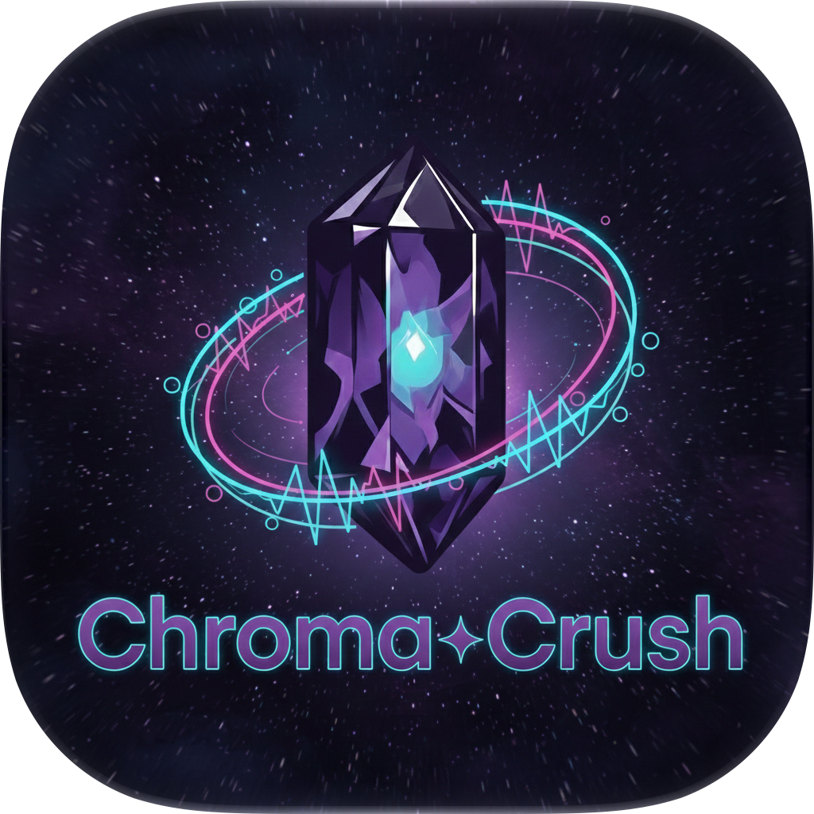
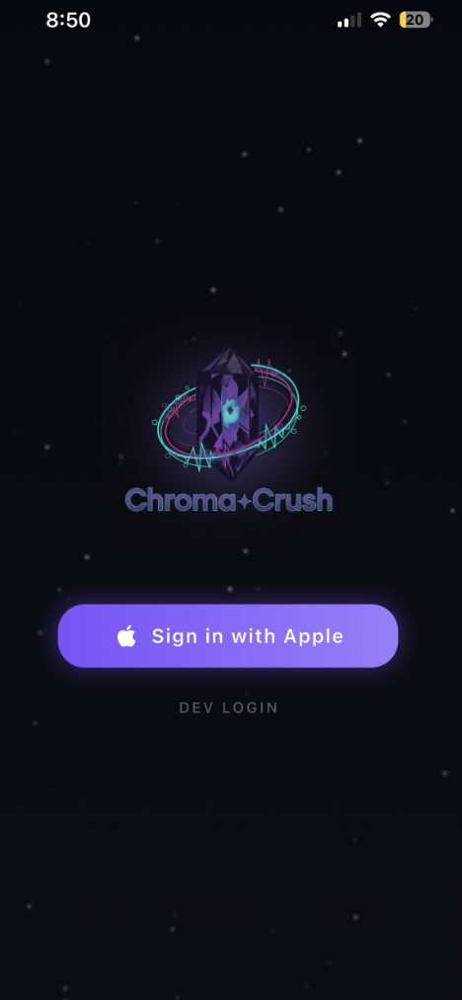
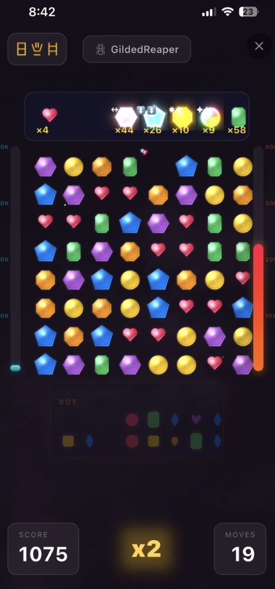
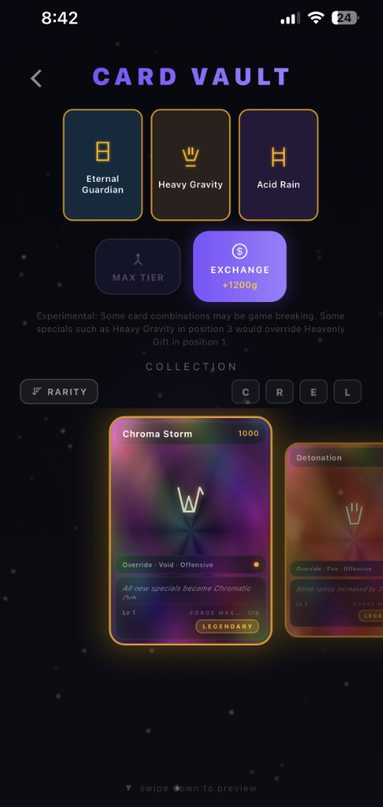

<p align="center">
  
</p>

# ChromaCrush

A server-authoritative match-3 engine and puzzle game built with FastAPI and Flutter/Flame.

The client sends a swap. The server validates it, resolves matches, runs cascades, handles special gems, obstacles, and card modifiers, and returns the steps. The client plays that timeline back, then snaps the board to the server's state.

There is no hosted service. The App Store listing has been sunset. Everything here runs locally.

<p align="center">
  
  
  
</p>

<p align="center"><a href="recording.mov">Preview recording</a></p>

## Architecture

- **One move pipeline.** PvP and the campaign both go through [`src/core/move_pipeline.py`](src/core/move_pipeline.py). The client cannot invent a match result.
- **Two grids, mutated in place.** Each cell is a color and a function, stored as parallel `int8` arrays. Cascade steps update that board in place (`apply_gravity_inplace`, `fill_empty_inplace`) instead of building a new board for every step.
- **Seeded randomness.** Board generation and per-move fills use a linear congruential generator. The seed mixes the player id with the level or the moves remaining, so the same inputs replay the same board.
- **Rules live in data.** Special creation, blast shapes, mega combos, and attraction are [`config/board_rules.json`](config/board_rules.json). [`EffectInterpreter`](src/modules/board/effect_interpreter.py) applies the schema.
- **Cards are a stateless hook layer.** [`CardModifierEngine`](src/modules/cards/modifier_engine.py) is built for one move and does no I/O. Its hooks cover spawn bias, special overrides, score multipliers, cascade injection, instant win, and energy grants.

## What you can play

- **Versus a bot.** The opponent is a real player on the server. It authenticates with an API key and chooses from server-generated move hints. Scoring stays on the server.
- **Campaign.** 120 single-player levels. The goal is to clear obstacles inside a move budget. Later levels add invincible walls, spreading obstacles, and tiles that come back. See [`docs/CAMPAIGN_MODE.md`](docs/CAMPAIGN_MODE.md).
- **Cards and gold.** Card definitions are JSON. Ownership, the vault, and the barter shop are in PostgreSQL.

## Layout

| Path | What it is |
|------|------------|
| `src/modules/` | Game rules, accounts, matches, campaign, cards, economy |
| `src/core/composition_root.py` | Wires services through constructor injection |
| `src/core/move_pipeline.py` | Shared move path for PvP and campaign |
| `chromacrush_app/` | Flutter / Flame client |
| `config/board_rules.json` | Specials, megas, and attraction |
| `config/campaign_levels.json` | 120 campaign levels |
| `docs/` | Game flow, render pipeline, and campaign notes |
| `tests/` | Unit tests, plus integration tests against local Postgres and Redis |

## Run it locally

Python 3.12+, Docker, and Flutter.

```bash
docker compose up -d

python -m venv .venv
source .venv/bin/activate          # Windows: .venv\Scripts\activate
pip install -e ".[dev]"
cp .env.example .env               # Windows: copy .env.example .env

alembic upgrade head
uvicorn src.main:app --reload
```

The API listens on `http://localhost:8000`. Health check: `GET /api/v1/health`.

```bash
pytest tests/unit -q
pytest                             # integration tests need the Docker containers

cd chromacrush_app
flutter analyze
flutter test
flutter run -d chrome              # or an iOS simulator / device
```

The client defaults to `http://localhost:8000`. Override it with `--dart-define=API_BASE_URL=...`.

The database password in `.env.example` is the local Docker Compose default.

## Further reading

- [Campaign mode](docs/CAMPAIGN_MODE.md)
- [Game flow and cascades](docs/GAME_FLOW_SURVEY.md)
- [Render pipeline](docs/RENDER_FLOW_SURVEY.md)
- [Database notes](DATABASE.md)

## License

Source-available under the [End-User License Agreement](LICENSE). You may read, run, and modify this software for personal and educational use. You may not sell it, charge for access to it, or include it in a product or service you sell.
